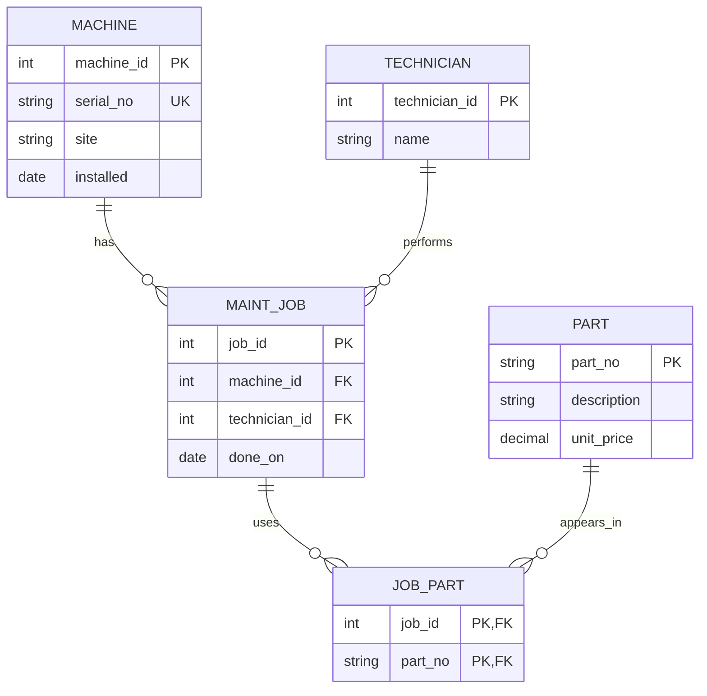

# Module 02 — ER audit of the maintenance database

## What the legacy schema currently contains

- **machine**: `machine_name, serial_no, site, installed`. Intended key: a stable `machine_id`; `serial_no` should be UNIQUE.
- **part**: `part_no, description, unit_price`. Intended natural primary key: `part_no`.
- **maint_job**: `job_id, machine_name, technician, done_on, parts_used`. Intended primary key: `job_id`; a real foreign key should point to machine.
- **technician** is hidden as a text value in `maint_job`, instead of a separate entity.
- **job_part** is missing entirely: comma-separated `parts_used` violates first normal form (1NF).

## Corrected intended ER diagram

This is the **intended redesigned model**, not a claim that these foreign keys exist in the legacy tables. The executable [contract.py](contract.py) uses a simpler transitional technician text field; splitting technicians into a table is a recommended next migration step.

## Cardinality proven with rows

- **1:1** is not expressed as a separate entity in the legacy database. A machine could have one nameplate row if this were split out.
- **1:n**: a machine can have many maintenance jobs. The legacy data has **2** rows for `cnc-01` (jobs 1 and 4), **1** for `cnc-02`, and **1 orphan** for `cnc-05`.
- **m:n**: a job can use multiple parts, and the same part can appear in multiple jobs. Job **1** lists **2** parts; job **2** lists `P-1003`, while job **3** also references `P-1001` used by job 1. The correct representation is `job_part(job_id, part_no)`.
- `SELECT job_id, parts_used, LENGTH(parts_used)-LENGTH(REPLACE(parts_used,',',''))+1 AS n_parts FROM maint_job;` gives **2, 1, 1, NULL** for jobs 1–4.

## Five defects (actual SQLite results from the provided dataset)

| Defect | SQL proof (see [defect-queries.sql](defect-queries.sql)) | Actual result | Why it matters |
|---|---|---|---|
| Orphan job | LEFT JOIN machine and filter NULL | `(3, cnc-05)` | A job cannot be linked to a real machine/site |
| Duplicate part | GROUP BY part_no HAVING COUNT>1 | `(P-1003, 2)` | Inventory and joins can double-count parts |
| Price stored as text | WHERE unit_price < '15' | `(P-1001, 12.50)` only | Text comparisons can exclude 9.90 incorrectly |
| Invalid date | installed NOT GLOB expected date shape | `(RANDOM-NAME, unknown)` | Date filtering/scheduling becomes unreliable |
| CSV list joined like a key | JOIN part ON part_no = parts_used | `(2,Coolant filter)` **twice**, `(3,Ball bearing 6203)` | Job 1 disappears; duplicated part row duplicates job 2 |

These query outputs were reproduced in SQLite using the course's given setup data; [setup.sql](setup.sql) rebuilds it.

## Correct business requirements

A machine has a stable identifier and unique serial number. Every maintenance job must reference a real machine. Every part has a unique ID and numeric nonnegative price. Dates must be dates, not free text. Each job has one technician; a job may use many parts, and each part may appear in many jobs. A job cannot list the same part twice.

## Natural vs surrogate keys; code contract

`part_no` is a **natural key** (business meaning). `machine_id` is a **surrogate key** (synthetic stable ID); `serial_no` remains UNIQUE. Pydantic in [contract.py](contract.py) checks the serial prefix and field types at the **application** boundary. SQLAlchemy produces PK/UNIQUE/FK constraints for the **database**, so invalid links are rejected even if another application connects. SQLite requires `PRAGMA foreign_keys=ON` per connection.

Note: the transitional contract does not yet enforce nonnegative `unit_price` or split `technician` into its own table. Those are additional improvements, not results already proven here.
