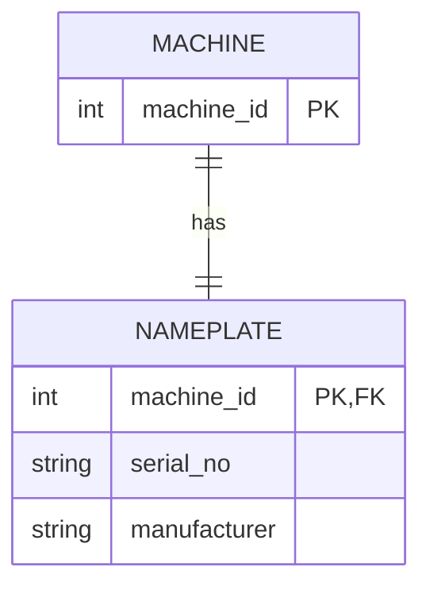
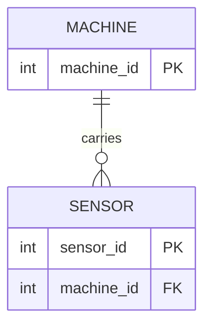
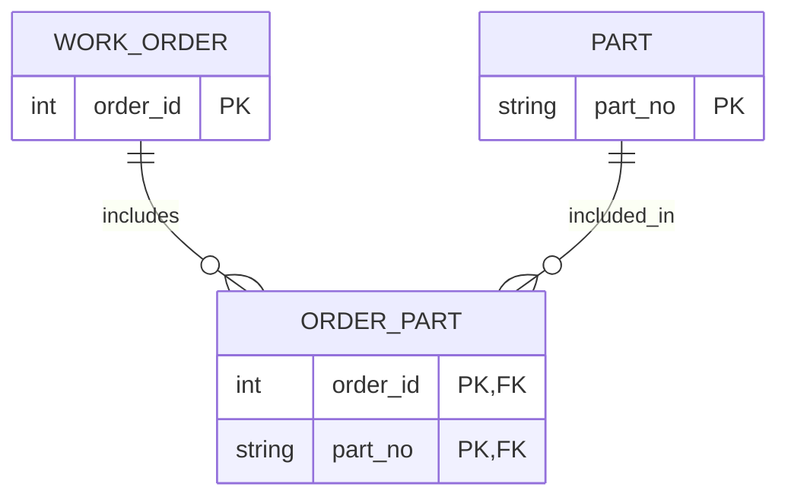
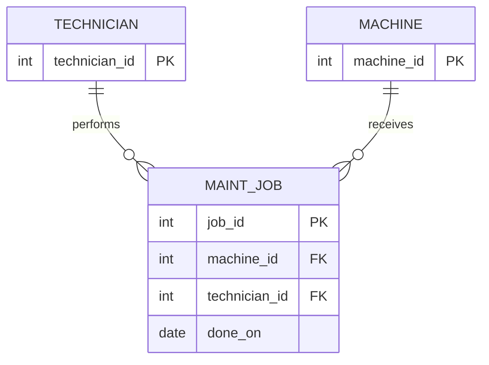

# Four short ER examples (Module 2 Task B)

## 1. Machine and nameplate (1:1)



Nameplate can be a separate entity if it has its own lifecycle. The FK is on NAMEPLATE, with PK/UNIQUE enforcing at most one plate per machine.

## 2. Machine and sensors (1:n)



Foreign key belongs on the *many* side: SENSOR.

## 3. Work orders and parts (m:n)



A junction table `ORDER_PART` has the composite PK `(order_id, part_no)`, preventing a repeated part in the same order.

## 4. Jobs, technicians and machines



A job is an **entity** because it has its own `job_id`, date, and potentially multiple parts. The technician is an entity; the name is an attribute.

## SQL proof for example 2

```sql
CREATE TABLE example_machine(machine_id INTEGER PRIMARY KEY);
CREATE TABLE example_sensor(sensor_id INTEGER PRIMARY KEY,
    machine_id INTEGER NOT NULL REFERENCES example_machine(machine_id));
INSERT INTO example_machine VALUES (1);
INSERT INTO example_sensor VALUES (100, 1), (101, 1);
SELECT machine_id, COUNT(*) AS sensors FROM example_sensor GROUP BY machine_id;
-- Expected: 1 | 2
```
