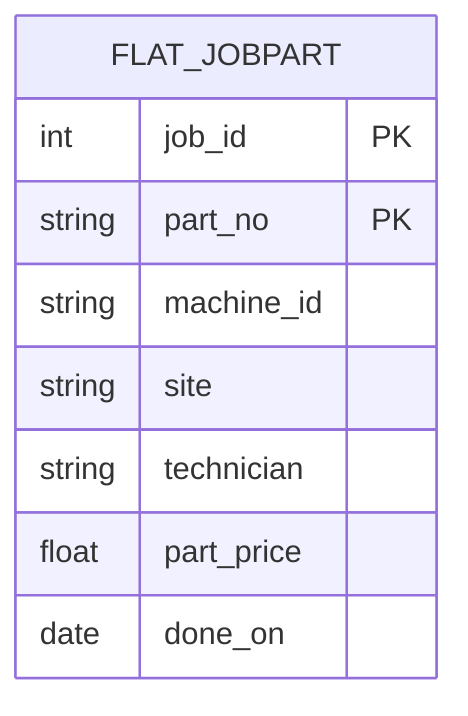
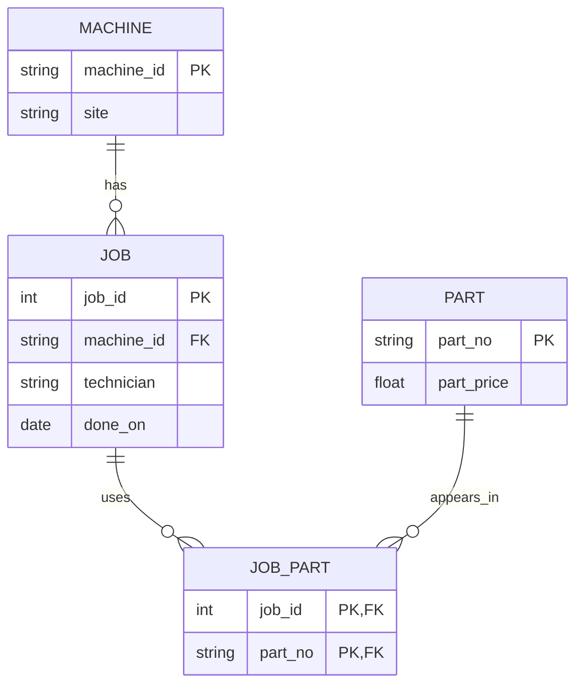

# Module 05 — Normalization notes and gates

Source: [Ulno's Module 5 studio](https://github.com/iotempire/iotempire-teaching/blob/main/full-classes/hsbi-databases-10d/modules/05-normalization-vs-denormalization.md). Work performed independently after missing the session; do **not** mark neighbour-pod gates as completed.

## Round 1 — See it: functional dependencies

Candidate key for a job-part row: **(job_id, part_no)**, assuming each part is recorded once per job. Domain assumptions: `job_id → machine_id, technician, done_on`, `machine_id → site`, and `part_no → part_price`. In the small five-row extract `job_id → machine_id` and `part_no → part_price` are consistent, but five rows alone do **not prove** they always hold: they require business rules. A rule such as `site → machine_id` is invalid because multiple machines can share a site. `technician → job_id` is also invalid because technicians can work on several jobs.

Flat model (redundant `site`, `technician` and `part_price` per part row):



3NF model (each non-key fact kept at its own level):



**What changes?** The repeated arrow `machine_id → site` no longer lives inside every flat job-part row. The machine's site is stored once in `machine`. Similarly, part price is kept in `part` rather than repeated per job.

## Round 2 — Break it: three concrete anomalies

The runnable script creates the professor's five-row `flat5` sample in memory. These are the minimal statements demonstrated:

```sql
-- Update anomaly: modify just one of cnc-01's rows; its sites now disagree.
UPDATE flat5 SET site='Bielefeld'
WHERE machine_id='cnc-01' AND part_no='P-0001';
SELECT DISTINCT site FROM flat5 WHERE machine_id='cnc-01';

-- Insert anomaly: there is no clean place to store an unused P-0999.
INSERT INTO flat5 VALUES(NULL,NULL,NULL,NULL,'P-0999',99.00);

-- Delete anomaly: deleting the only P-0002 usage also erases its price.
DELETE FROM flat5 WHERE part_no='P-0002';
```

These statements are a teaching demonstration, **not** a safe production migration.

## Round 3 — Build it: normalize to 3NF

`setup.sql` builds **20,000 jobs × 10 parts = 200,000 flat rows**, then decomposes them into 50 `machine` rows, 10 `part` rows, 20,000 `job` rows, and 200,000 `job_part` rows. The 3NF join reproduces the same grouped totals as the denormalized report. `PRAGMA foreign_keys=ON` and `PRAGMA foreign_key_check` provide integrity evidence.

The `part` table has **10**, not 40, rows because the supplied generator uses `k` from 1 to 10 in `P-` + `(k % 40)+1`: despite the modulo 40, only 10 distinct part numbers are generated.

- **1NF:** each cell holds one atomic part ID instead of a comma-separated list.
- **2NF:** move `part_price`, which depends on part_no alone, out of the composite `(job_id, part_no)` relation.
- **3NF:** move the transitive dependency `machine_id → site` into the machine table (rather than copying site across job-part rows).

## Round 4 — Race it

See `results.txt` for **real local warm-cache median times** and `EXPLAIN QUERY PLAN` from the two equivalent aggregation queries. The test discards one warm-up and alternates five timed runs per query. The normalized query joins `job`, `machine`, `job_part`, `part`; the report query scans the deliberately duplicated `report_jobpart` table. They return the same totals; the ratio depends on cache, storage and the planner.

## Round 5 — Price it

Changing one machine (`cnc-02`) touches **1 row in `machine`** but **4,000 in `report_jobpart`**, because that machine has 400 jobs and 10 parts per job. Both updates are executed within a SAVEPOINT and rolled back, leaving `normalize.db` ready for Module 06a. `results.txt` records the observed update times, `dbstat` table-only storage, and the index-drop experiment; the index is restored afterwards. Check the result on Windows too: timings are not portable.

## Round 6 — Decide

Read the separate [memo](memo.md) to Yasmin Kaya. It recommends 3NF as the source of truth and a deliberate, refreshed report table for dashboards, using observed numbers rather than treating denormalization as automatically faster.

## Round 7 — Harvest: questions to take to a neighbour

1. Why does `CROSS JOIN` yield 200,000 records without writing 200,000 INSERTs?
2. Why is `part_price` stored as `TEXT` in `flat_jobpart` but `REAL` in `part`? Would integer cents be safer for money?
3. Why can a full index scan be **slower** than a table scan? Look at both plans.
4. Why does `SELECT DISTINCT` assume a unique technician per job? What if it is false?
5. What happens when a site changes in 3NF but the reporting snapshot is not refreshed?

**Pod gate status:** not performed; this work was completed independently after the missed lecture. Discuss these with the nearest pod in the next session and record actual feedback afterwards.
